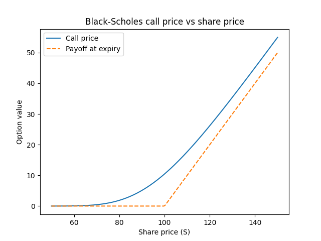
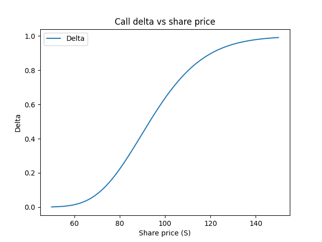
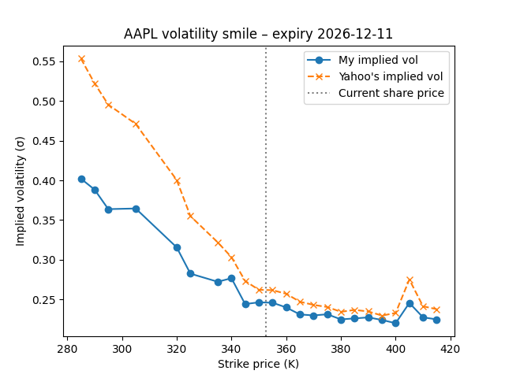

# Options Pricer
**Live app:** https://mckenna-options-pricer.streamlit.app
A Python options pricing tool built from scratch to learn the maths behind derivatives pricing.

## What it does
- **Black–Scholes pricing** of European call and put options (put via put–call parity)
- **Monte Carlo pricing** by simulating share prices with geometric Brownian motion, converging to the Black–Scholes price as simulations increase
- **Greeks**: delta and vega, with delta checked numerically against the slope of the price curve
- **Interactive Streamlit app**: move sliders for share price, strike, time, interest rate and volatility to see prices and Greeks update live
- **Implied volatility**: a bisection solver that backs out σ from live Apple option prices (via yfinance), revealing the volatility skew that Black–Scholes' constant-volatility assumption misses

## Charts




## Example
S = 100, K = 100, T = 1 year, r = 5%, σ = 20% → Call ≈ 10.45, Put ≈ 5.57, Delta ≈ 0.637

## Run it yourself
```
pip install -r requirements.txt
streamlit run app.py
```

## Files
| File | Purpose |
|---|---|
| `black_scholes.py` | Black–Scholes call, put, delta and vega |
| `monte_carlo.py` | Monte Carlo call pricer |
| `greeks.py` | Plots the call price curve and delta |
| `app.py` | Streamlit web app |
| `implied_vol.py` | Bisection solver for implied volatility |
| `smile.py` | Pulls live AAPL options and plots the volatility smile |

## What I learned
How Black–Scholes and Monte Carlo pricing connect, why option value rises with volatility, and how to turn maths into vectorised NumPy code.

Built with Python, NumPy, SciPy, Matplotlib and Streamlit.